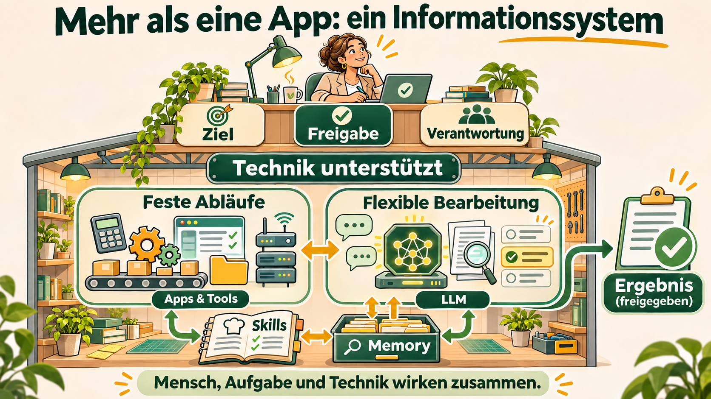
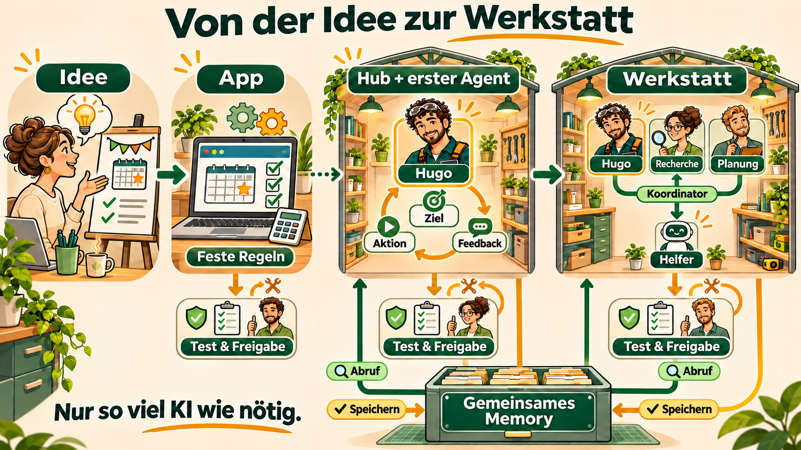
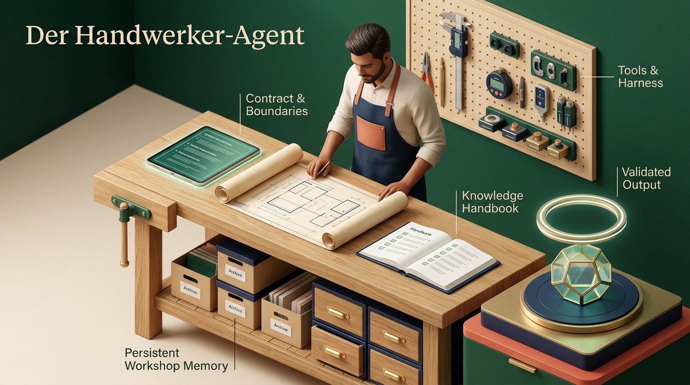

# Trinity Agenten: Dein Helfer. Dein Hub.

Praxisleitfaden für Menschen · Prof. Dr. Mathias Engel · HfWU

Fassung vom 05.11.2026. Dieser Leitfaden beschreibt den zu bauenden Hub, keine bereits lauffähige Anwendung.

## TL;DR: Was bekomme ich?

Du beschreibst, wobei Du Unterstützung brauchst. Ein programmierfähiges LLM baut Dir daraus einen kleinen **Hub mit Deinem ersten Spezialisten** – etwa Hugo HUBmeister. Du nutzt ihn wahlweise im **Codex-Chat oder über eine HTML-Oberfläche auf Deinem PC/Mac**. Beide Zugänge gehören zum selben System. Weitere Spezialisten kommen als Kacheln hinzu. Alle greifen auf dasselbe gemeinsame Gedächtnis zu: **erst nachschlagen, dann arbeiten, geprüfte Erkenntnisse merken.** Du entscheidest über neue Zugriffe, Kosten und die Freigabe.

Ein Hub, zwei Zugänge. KI-generierte Infografik, 2026; Hugo nach profengel.de.

Drei Ansichten genügen: **Chat** für Aufträge und Ergebnisse · **Kacheln** für Spezialisten · **Einstellungen** für Modelle, Rechte und Updates. Technikdetails erscheinen erst bei Bedarf.

## 1. App, Skill oder Agent?

**App:** erledigt einen vorgegebenen Ablauf, beispielsweise Anmeldungen zählen und freie Plätze berechnen. Eine nützliche Oberfläche braucht dafür nicht zwingend KI.

**Skill:** eine Fähigkeit oder Arbeitsanleitung, etwa „Prüfe ein Angebot nach diesen Kriterien“. Sie allein ist noch kein Agent.

**Agent:** bekommt ein Ziel, wählt im erlaubten Rahmen nächste Schritte, benutzt Werkzeuge und prüft Rückmeldungen. Beispiel: „Plane eine Veranstaltung innerhalb des Budgets; frage nach, bevor Du etwas buchst.“

Mehr als eine App: ein Informationssystem. Eigene Darstellung nach Winter [1]; KI-generiert, 2026.

Das Gesamtbild ist ein **Informationssystem**: Menschen, Aufgaben und Technik wirken zusammen. Feste Berechnungen übernehmen Apps und Werkzeuge; bei Sprache und unklaren Situationen kann ein LLM helfen. Auch das LLM ist Technik – kein menschlicher Mitarbeiter. Ziele, Freigaben und Verantwortung bleiben bei Menschen. „Nicht deterministisch“ bedeutet nicht „nicht automatisierbar“.

## 2. Klein anfangen. Bei Bedarf wachsen.

Von der Idee zur Werkstatt. KI-generierte Infografik, 2026.

1. **Idee:** Welches Problem soll gelöst werden? Woran erkennst Du ein gutes Ergebnis?
2. **App:** Klare Regeln als Software umsetzen. Reicht das bereits, bleibt es dabei.
3. **Hub + erster Agent:** Für flexible Aufgaben kommt ein Spezialist dazu. Der Hub entsteht sofort mit seiner ersten Kachel, nicht erst bei Agent Nummer zwei.
4. **Werkstatt:** Weitere Spezialisten und gegebenenfalls Unteragenten arbeiten in einem abgestimmten Ablauf zusammen. Nicht jede Aufgabe benötigt mehrere Agenten.

Nach jeder fertiggestellten Stufe mit Code folgt: **Funktion und IT-Sicherheit prüfen → Fehler beheben → erneut testen → menschlich freigeben.** Ein schönes Bild oder eine überzeugende Antwort ersetzt diese Prüfung nicht.

## 3. Was Dein Helfer mitbringt

Der Agent als Handwerker. Vorhandenes Metapherbild aus dem ursprünglichen Trinity-Leitfaden.

Ein Handwerker braucht einen **Auftrag**, **Fähigkeiten**, **Werkzeuge**, **Erfahrungswissen** und einen **Qualitätscheck**. So ist auch Dein Agent aufgebaut. Skills sind seine Arbeitsanleitungen; der Harness ist seine Arbeitsumgebung, die Modell und Werkzeuge verbindet und Grenzen durchsetzt. Ein LLM muss nicht alles selbst erledigen: Rechnen, Dateien prüfen und feste Abläufe können zuverlässige Softwarewerkzeuge übernehmen.

Nicht jeder Spezialist braucht das größte Modell. Ein leistungsfähiges Modell kann bauen und verbessern; ein kleineres, eventuell lokales Modell kann passende Aufgaben ausführen. Ob es dafür gut genug ist, zeigen mehrere Testaufgaben – nicht die Modellgröße allein.

## 4. Ein Gedächtnis, das wirklich genutzt wird

Alle Agenten verwenden **denselben Memory-Dienst**, zum Start eine gemeinsame lokale SQLite-Datenbank. Vor einer Aufgabe suchen sie dort nach passenden Erfahrungen. Danach speichern sie nur sinnvolle geprüfte Erkenntnisse, mit Quelle und Gültigkeit. Fehler müssen korrigierbar und Einträge löschbar sein.

**Nachschlagen → arbeiten → prüfen → merken → später wiederverwenden.**

Gemeinsamer Speicher heißt nicht „jeder darf alles lesen“: Projektwissen und sensible Inhalte bleiben durch Rechte getrennt. Passwörter gehören nicht hinein. Feedback verbessert das nutzbare Wissen, trainiert aber nicht automatisch das Modell.

## 5. So gibst Du Deinen Hub in Auftrag

1. **Aufgabe beschreiben:** Was soll Dein erster Helfer tun, mit welchen Daten und welchem Ergebnis?
2. **LLM-Version übergeben:** Gib die separate Bauanleitung einem LLM mit Programmier- und Ausführungswerkzeugen, beispielsweise hier in Codex. Ein gewöhnlicher Chat ohne solche Werkzeuge kann nicht selbst auf Deinem Rechner installieren.
3. **Bauplan prüfen und freigeben:** Benötigte Zugriffe, Modellkosten, Speicherort und Grenzen werden vorher erklärt. Fehlende Angaben werden erfragt.
4. **Beide Zugänge abnehmen:** Im Codex-Chat einen Auftrag starten und in der HTML-Oberfläche wiederfinden – einschließlich derselben Ergebnisse und Erinnerungen. Danach Neustart und unberechtigte Zugriffe testen.

Die HTML-Seite bedient einen lokalen Hintergrunddienst; sie allein führt noch keine Agenten aus. Der normale Hub-Betrieb soll auch ohne geöffnetes Codex-Fenster funktionieren. Neue Helfer und Verbesserungen kannst Du anschließend im Hub anfordern. Fehlende Entwicklungswerkzeuge oder Sicherheitsvoraussetzungen werden angezeigt, nicht überspielt.

### Sicherheitscheck: kein Zusatz, sondern Pflicht

Jeder erzeugte oder geänderte Agent und Code wird mit passenden **IT-Security-Tools** geprüft, zum Beispiel Bandit/Semgrep, pip-audit und Gitleaks. Zusätzlich sollen **zwei oder drei unterschiedliche LLMs unabhängig** prüfen. Optional bündelt ein Moderator die Berichte als Konzil. Nicht freigegebene Daten oder Geheimnisse dürfen dabei nicht an Cloudmodelle gehen.

Offene kritische oder hohe Risiken blockieren die Aktivierung. Fehlende Prüfungen gelten nicht als bestanden. Nach Änderungen wird erneut geprüft; erst dann gibt ein Mensch den geprüften Stand frei. Auch dieser Ablauf garantiert keine Fehlerfreiheit.

### Zum Weitergeben

- [LLM-Bauanleitung als Markdown](TrinityAgenten_Leitfaden_LLM.md)
- [LLM-Bauanleitung als Textdatei](TrinityAgenten_Leitfaden_LLM.txt)
- [Kurzer Praxisleitfaden als PDF](Trinity_Agent_Praxisleitfaden_HfWU.pdf)

## Quellen und Einordnung

[1] Robert Winter: [Informationssystem-Architektur, Enzyklopädie Wirtschaftsinformatik](https://wi-lex.de/lexikon/informations-daten-und-wissensmanagement/informationsmanagement/information/informationssystem-architektur/). Das Hybrid-Hub-Bild ist eine eigene didaktische Übertragung, keine Produktbeschreibung dieser Quelle.

[2] [SQLite: Einsatzmöglichkeiten und Grenzen](https://www.sqlite.org/whentouse.html). [Bandit](https://bandit.readthedocs.io/en/latest/), [Semgrep](https://docs.semgrep.dev/), [pip-audit](https://github.com/pypa/pip-audit) und [Gitleaks](https://github.com/gitleaks/gitleaks): offizielle Werkzeugdokumentationen. Die Eignung ist beim konkreten Projekt zu prüfen.

Hugo: virtuelle Figur nach [profengel.de](https://profengel.de/). Drei neue Infografiken mit integrierter OpenAI-Bildgenerierung erstellt und visuell geprüft. Produktionsprompts und Herkunft: [Medienmanifest](Trinity_Medienmanifest.json). Die Beschreibung ist ein Zielbild, kein Nachweis einer bereits implementierten oder sicherheitsgeprüften Hub-Version.

[Frühere Fassung im Backup](https://profengel.github.io/KI-Literacy/backup/trinity-agenten/2026-11-05/).
